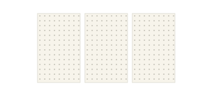
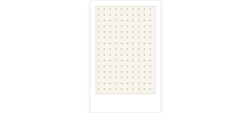

# Way Kurap

**A nostalgic photo booth in your browser. Pose, pick a frame, and download your memories.**

Way Kurap turns a camera-equipped phone or laptop into a photo booth for birthdays, weddings, gatherings, or spontaneous shots. Take a timed sequence of photos, choose a frame and orientation, and export the finished strip as a PNG.

There is no sign-up or photo upload step. Capture, preview, and image composition happen on the user's device, with photos held in browser memory for the current session.

## Contents

- [Features](#features)
- [Using the booth](#using-the-booth)
- [Privacy and security](#privacy-and-security)
- [Technology](#technology)
- [Local development](#local-development)
- [How it works](#how-it-works)
- [Project structure](#project-structure)
- [Testing](#testing)
- [Deployment](#deployment)
- [Customization](#customization)
- [Limitations and troubleshooting](#limitations-and-troubleshooting)
- [Contributing](#contributing)

## Features

| Feature | Behavior |
| --- | --- |
| Camera consent | The camera stays off until the user selects **Enable camera** and grants browser permission. |
| Photo sequences | Choose **3, 4, or 5 photos**; the default is 4. |
| Timed capture | A brief **Get Ready** message precedes a 10-second countdown for the first photo and a 5-second countdown for each later photo. |
| Capture feedback | A live preview, visible countdown, and flash effect help users time their poses. |
| Frame selection | Choose **No Frame**, **Polaroid**, or **Film Strip**. |
| Orientation | Arrange the finished strip vertically or horizontally. |
| PNG export | Download one composed image, with transparent areas around the layout and through film-strip sprocket holes. |
| Retake | Clear the current photos and return to capture. |
| End session | Clear photos from the booth and return home, stopping any active camera stream. |
| Visual identity | Cream, red, and dark tones, checkerboard accents, and a pointer-following eye logo create a retro booth aesthetic. |

The layouts adapt to smaller screens. The landing page includes a skip link, and the eye animation respects reduced-motion preferences.

### Frame styles

These illustrations preview the available styles; they are not screenshots of captured photos.

| No Frame | Polaroid | Film Strip |
| --- | --- | --- |
|  |  |  |
| A simple arrangement with thin photo outlines. | Overlapping, rotated white photo cards. | A dark strip with transparent sprocket holes. |

## Using the booth

1. Open the home page and select **Start photobooth**.
2. Read the privacy notice, select **Enable camera**, and allow camera access in the browser.
3. Choose how many photos to take and press the shutter button.
4. Pose through the countdowns; the booth opens the review screen after completing the sequence.
5. Pick a frame and orientation, then select **Export photos** to download the PNG.
6. Select **Retake** for another sequence or **End session** to clear the booth and return home.

The exported filename follows `photobooth-strip-<timestamp>.png`. Download or save behavior depends on the browser, especially on mobile devices.

## Privacy and security

- **Photos stay local:** the current app does not upload photos, store them in a database, or persist them in browser storage.
- **Temporary sessions:** photos and selections live in React state while navigating between capture and review. Reloading or leaving the booth for the home page clears that session.
- **Video only:** the app requests camera access without microphone access.
- **Camera cleanup:** leaving capture stops camera tracks, including a permission request that finishes after navigation.
- **User-controlled cleanup:** End session clears the booth's photos; it cannot delete files already downloaded to the device.
- **Browser protections:** response headers restrict device permissions, prevent framing and plugin embedding, and limit form destinations, base URLs, MIME sniffing, and referrer disclosure.
- **Dependency maintenance:** Dependabot checks npm dependencies weekly once its configuration is on the repository's default branch.

The Content Security Policy is a baseline policy, not full script-injection protection. Hosting providers may retain request metadata even though the app does not upload photos. See [SECURITY.md](SECURITY.md) for security limits and the deployment checklist.

## Technology

| Technology | Role |
| --- | --- |
| Next.js 16 / App Router | Routing, layouts, builds, and HTTP response headers. |
| React 19 | Interactive screens, hooks, and shared session state. |
| TypeScript | Application types and component contracts. |
| Tailwind CSS 4, CSS Modules, and global CSS | Responsive layouts and visual styling. |
| Lucide React | Interface icons. |
| Browser MediaDevices API | Camera permission and video streaming. |
| Canvas 2D API | Capturing video frames and composing PNG downloads. |
| Node.js test runner and ESLint | Regression checks and static analysis. |

Exact versions are recorded in [package.json](package.json) and [package-lock.json](package-lock.json). No database, authentication service, external image-processing API, or environment variables are required for the current application.

## Local development

### Requirements

- **Node.js 24** and npm, matching the runtime used to validate the project and its tests.
- A browser with camera and Canvas 2D support.
- A connected camera and permission to use it.

Clone this repository using GitHub's **Code** menu, then open a terminal in the project directory:

```bash
npm ci
npm run dev
```

Visit [http://localhost:3000](http://localhost:3000). No `.env` file is needed.

Camera access requires a secure context: localhost works for development, while a deployed site must use HTTPS. Opening an ordinary HTTP LAN address from a phone may prevent camera access; use an HTTPS deployment for device testing.

### Commands

| Command | Purpose |
| --- | --- |
| `npm run dev` | Start the development server. |
| `npm run build` | Create a production build and check TypeScript. |
| `npm start` | Serve an existing production build. |
| `npm run lint` | Run ESLint. |
| `npm test` | Run the regression suite. |
| `npm audit` | Check dependency versions against npm's advisory registry. |

To try the production build locally:

```bash
npm run build
npm start
```

## How it works

### Routes

| Route | Purpose |
| --- | --- |
| `/` | Landing page with an introduction, workflow, and frame previews. |
| `/step-1` | Camera consent, live preview, photo-count selection, and timed capture. |
| `/step-2` | Photo review, frame and orientation selection, retake, and export. |

The `(booth)` directory is a route group, so it does not appear in the URL. Its layout provides shared session state for both booth screens. Opening `/step-2` without photos redirects to `/step-1`.

### Photo lifecycle

```text
Enable camera -> Live video -> Timed canvas captures
                                      |
                            Photos in React state
                                      |
                         Frame + orientation preview
                                      |
                           Canvas composition -> PNG download
```

`useCamera` manages camera permission, the video reference, and stream cleanup. `usePhotoCapture` draws video frames onto a canvas and converts them to PNG data URLs. Once a full sequence is captured, the capture page stores the results in `PhotoSessionProvider` and navigates to review.

`exportPhotos` loads those images, draws the selected layout onto another canvas, and triggers a local download. Preview uses HTML/CSS while export uses canvas drawing, so changes to a frame need to be reflected in both implementations.

## Project structure

```text
app/
  page.tsx                  Landing page
  page.module.css           Landing-page styles
  layout.tsx                Root layout and site metadata
  globals.css               Shared styles
  (booth)/
    layout.tsx              Booth shell and session provider
    step-1/page.tsx          Capture screen
    step-2/page.tsx          Review and export screen
components/
  PhotoSession.tsx          Shared photos and selections
  EndSession.tsx            Session cleanup and return-home action
  EyeLogo.tsx               Interactive eye mark
  ...                       Camera, selector, and action components
hooks/
  useCamera.ts              Camera lifecycle
  usePhotoCapture.ts        Countdown and capture sequence
lib/
  exportPhotos.ts           Canvas layouts and PNG download
  eyeTracking.ts            Pupil movement calculations
constants/config.ts         Photo counts and frame constants
public/                     Logo and frame illustrations
tests/                      Capture, export, and header regression checks
.github/dependabot.yml       Weekly dependency-update configuration
next.config.ts              Browser security headers
SECURITY.md                 Privacy behavior and operational safeguards
```

Some unit tests sit alongside their source files in `hooks/` and `lib/`. The routed pages currently compose their own controls; standalone selector and preview components also remain in `components/`.

## Testing

```bash
npm run lint
npm test
npm run build
```

The automated suite covers:

- First-shot and subsequent-shot countdown timing.
- Cancelling capture when the component unmounts.
- Navigation after complete capture, empty-session redirects, retake, and session cleanup.
- Explicit camera activation, video-only constraints, and cleanup of active or delayed streams.
- PNG composition for all frame styles and both orientations, including transparent film holes.
- Pupil movement boundaries and configured security headers.

These are unit and component-level checks with mocked browser APIs, not physical-camera or end-to-end browser tests. Before publishing, manually test permission denial, capture, export, retake, and End session on desktop and mobile. Confirm that leaving capture turns off the browser's camera indicator.

## Deployment

### Vercel

1. Push reviewed code to a GitHub repository.
2. In Vercel, select **Add New → Project** and import that repository.
3. Use the **Next.js** framework preset and the directory containing `package.json` as the root.
4. Use `npm run build` as the build command and keep the framework's default output settings.
5. Select Node.js 24 where available. No application environment variables are currently required.
6. Deploy and test the generated HTTPS URL before sharing it.

See [Vercel's Git deployment documentation](https://vercel.com/docs/git) for repository integration and automatic deployments. Configure preview protection, account security, and usage controls using [SECURITY.md](SECURITY.md).

### Other Node.js hosts

Install dependencies with `npm ci`, run `npm run build`, and launch with `npm start`. Configure HTTPS at the hosting layer and verify that security headers reach the browser. Although photo processing is local, the site still needs hosting to deliver its pages and assets.

## Customization

| Change | Starting point |
| --- | --- |
| Photo-count choices | `PHOTO_COUNTS` in `constants/config.ts`; the second entry is used as the session default. |
| Countdown timing | `hooks/usePhotoCapture.ts`; update its tests and explanatory copy too. |
| Frame appearance | Review-page markup and `app/globals.css` for previews; `lib/exportPhotos.ts` for downloads. |
| Frame choices | The review page's local frame list, frame constants, and any affected selector components. |
| Default frame or orientation | `components/PhotoSession.tsx`. |
| Landing-page content and styling | `app/page.tsx` and `app/page.module.css`. |
| Branding and metadata | `components/EyeLogo.tsx`, `public/`, and `app/layout.tsx`. |
| Browser security policy | `next.config.ts` and `tests/security-headers.mjs`. |

## Limitations and troubleshooting

| Situation | What to know or try |
| --- | --- |
| Camera is unavailable | Check browser and operating-system camera permissions, close other apps using the camera, and reload before enabling it again. |
| Camera works locally but not on another device | Verify HTTPS; an HTTP LAN address is not equivalent to localhost. |
| Photos disappear after refresh | Sessions are held in memory; export photos before reloading or ending the session. |
| Review redirects to capture | There are no photos in the current session. Complete a new capture sequence. |
| Downloads behave differently on mobile | Check the browser's download/save interface and test the target device before an event. |
| Large captures use substantial memory | Capture and export use in-memory images and canvases; performance depends on camera resolution and device resources. |

There is currently no saved gallery, cloud backup, built-in social sharing, camera picker, or individual-photo editing. Export dimensions follow the camera's video resolution and the selected layout; this is not a fixed-size print-template system.

## Contributing

Keep changes focused and follow the existing component and styling patterns. Read [AGENTS.md](AGENTS.md) and the relevant installed Next.js guides before changing framework-dependent code. Update regression coverage when changing behavior, run the checks above, and describe the user-visible result in the pull request.

For camera or export issues, include the browser, operating system, selected photo count, frame, orientation, and reproduction steps. Avoid attaching private photos or credentials to public issues.
